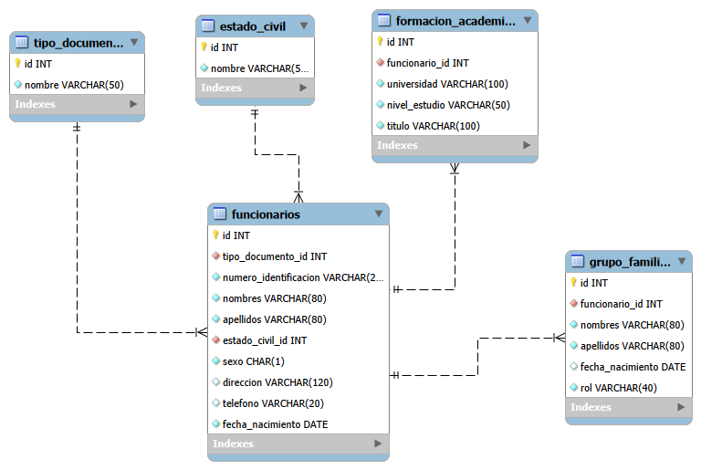

# Gestión de funcionarios - RRHH IU Digital

CRUD de funcionarios en Java Swing con patrón DAO y manejo de excepciones.

## Integrantes
- Wilfer (agrega aquí los demás nombres)

## Tecnologías
Java, Swing, Maven, MySQL 8, JDBC.

## Cómo ejecutar
1. En MySQL Workbench ejecuta `SQL/01_crear_bd.sql` y luego `SQL/02_poblar_bd.sql`.
2. Configura las variables de entorno `RRHH_DB_USER` y `RRHH_DB_PASS`
   (por defecto usa `root` y clave vacía).
3. Abre el proyecto en NetBeans y ejecuta `com.iudigital.rrhh.Main`.

## Modelo relacional

